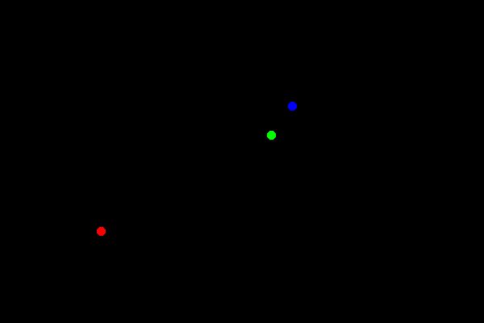
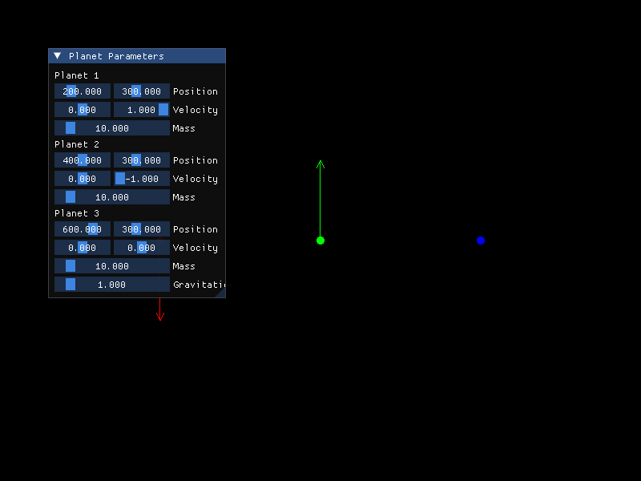

# Three-Body Problem

A 2D gravity simulation of three bodies in C++, with SFML for drawing and Dear ImGui for live parameter editing.





Paused state: the arrows show each body's velocity. Position, velocity and mass of each body and the gravitational constant G can be changed with the sliders.

The animation above was run with these values (set with the sliders): positions (275, 367), (486, 248), (513, 212), velocities (-0.33, -0.70), (-0.10, 0.59), (-0.54, -0.90), masses 27, 16, 10, G = 6.2.

## How it works

Every frame, for each pair of bodies:

```
F = G * m1 * m2 / d^2     (direction: towards the other body)
v += F / m * dt
x += v * dt               (dt = 0.1)
```

Each body leaves a trail. When two bodies touch, both are removed and a white flash marks the collision.

## Controls

| Key | Action |
|---|---|
| Space | Start / pause |
| R | Reset to the default positions |

## Build

Needs SFML 2.5+ and Eigen 3. ImGui and ImGui-SFML are git submodules.

```bash
git clone --recursive https://github.com/ambroise-galle/ThreeBodyProblem.git
cd ThreeBodyProblem
cmake -S . -B build -DIMGUI_DIR=$PWD/imgui -DBUILD_SHARED_LIBS=ON
cmake --build build
./build/ThreeBodyProblem
```

On macOS: `brew install sfml@2 eigen`. On Ubuntu: `sudo apt install libsfml-dev libeigen3-dev`.

`main copy.cpp` is an earlier version without the ImGui panel.
